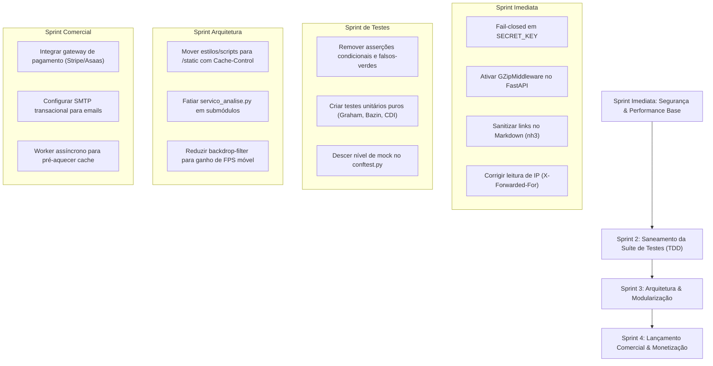

# Relatório Mestre de Auditoria 360° — Investidor IA
**Framework:** `agent-skills` (25 Skills & 4 Subagentes Especializados)  
**Data:** 21 de Outubro de 2026  
**Repositório:** `app_investimentos` (B3 Rentável / Dossiê Didático em 4 Blocos)  
**Avaliadores Especializados:** Senior Code Reviewer, Security Engineer, QA & Test Engineer, Web Performance Auditor, Orchestrator.

---

## 1. Visão Executiva & Scorecard Geral

O projeto **Investidor IA** atingiu um patamar de maturidade técnica e de produto muito elevado:
- **110 testes automatizados** passando com SQLite em memória (isolamento total de produção Neon);
- **Aderência exemplar às regras de produto de AGENTS.md** (R1 a R8): Dossiê em 4 blocos sem economês, confrontação factual Anti-Guru (SGS/BCB e histórico auditado), busca por marcas do cotidiano com didática para cooperativas (Sicredi/Sicoob), e isolamento de instâncias `yf.Ticker` por thread;
- **Zero Schema Drift** no banco Neon e migração Alembic idempotente para online e offline.

No entanto, a ativação da suíte completa de **25 skills** e dos **4 subagentes especializados** revelou um raio-X aprofundado com oportunidades vitais de refatoração antes do lançamento público e da monetização:

| Eixo / Fase | Score (0 a 100) | Veredito | Principais Destaques |
| :--- | :---: | :---: | :--- |
| **1. DEFINE** | **94** | Aprovado | Alinhamento total com a dor do investidor leigo (Anti-Guru, Dossiê 4 Blocos). |
| **2. PLAN** | **85** | Aprovado com Ações | Roadmap do Dossiê v2 completo; pendente gateway de pagamento e filas de background. |
| **3. BUILD & VERIFY** | **78** | Requer Ajustes | Pirâmide invertida (testes E2E excessivos vs poucos unitários), monólito em `servico_analise.py`. |
| **4. REVIEW & QUALITY** | **76** | Requer Ajustes | Fallback de `SECRET_KEY`, sanitização de links Markdown, tokens de senha reutilizáveis. |
| **5. SHIP & EVOLUTION** | **82** | Aprovado com Ações | Migrações Alembic excelentes; necessidade de GZip middleware, HSTS e headers de segurança. |
| **6. ENGENHARIA & META** | **88** | Aprovado | Zero CDNs externas, tipografia nativa, convenções de código claras e documentadas. |

---

## 2. Fase 1: DEFINE (Definição, Escopo & Contratos)
*Skills acionadas:* `spec-driven-development`, `interview-me`, `idea-refine`, `constraint-driven-development`, `api-and-interface-design`.

### 2.1. O Problema Real do Usuário (Alinhamento de Produto)
O produto endereça uma falha crítica do mercado financeiro brasileiro: **o investidor iniciante, atraído por falsas promessas de gurus de redes sociais ("5% ao mês garantido"), não entende termos como P/VP, P/L e ROE e abandona a Bolsa ou é lesado.**
- **Regra R1 (Zero Economês Isolado):** Cumprida com louvor no dicionário `TRADUCAO_MULTIPLOS_R1`, trazendo analogia do dia a dia, contexto setorial e impacto prático no bolso.
- **Regra R2 (Anti-Guru Factual):** O Bloco 2 usa dados auditados da B3 (histórico real com mês/ano) e índices oficiais do Banco Central (SGS 12 - CDI com tabela regressiva de IR e SGS 195 - Poupança), exibindo com honestidade períodos de queda e empresas com histórico curto.
- **Regra R3 (Marcas da Rua & Cooperativas):** O motor de busca resolve termos como "Magalu" (MGLU3), "Posto Ipiranga" (UGPA3) e intercepta cooperativas não listadas ("Sicredi", "Sicoob", "Cresol") com explicação pedagógica e sugestão de bancos da B3.
- **Regra R4 (Dossiê em 4 Blocos):** Arquitetura limpa: Bloco 1 (O que a empresa faz), Bloco 2 (Realidade vs Guru), Bloco 3 (Concorrentes e Macro) e Bloco 4 (Calculadora de Premissas e Valuation).

### 2.2. Contratos de API e Interfaces
- Rotas REST e SSR bem desenhadas no FastAPI:
  - `GET /`: Home page com busca por marcas e atalhos de tickers populares.
  - `GET /analisar?ticker=...`: Dossiê em 4 blocos com renderização server-side.
  - `GET /api/sugestoes?q=...` & `/api/buscar-ativos?q=...`: Autocomplete com suporte ARIA.
  - `POST /api/simular-bloco4`: API de recálculo de premissas financeiras.
  - `POST /login`, `POST /cadastro`, `POST /conta/excluir`, `GET /logout`: Gestão de identidade.
- **Ponto de Melhoria no Contrato:** O endpoint `/logout` utiliza método `GET`. Deve ser migrado para `POST` para evitar acionamentos acidentais via pré-carregamento de links ou CSRF.

---

## 3. Fase 2: PLAN (Planejamento, Roadmap & Tarefas)
*Skills acionadas:* `planning-and-task-breakdown`.

### 3.1. Estado Atual do Roadmap
- [x] **Passo 0:** Higiene de repositório, `.gitignore` seguro para `.claude/` e branch única.
- [x] **Passo 1:** Dossiê Bloco 2 com histórico real de 5 anos, quedas reais e séries SGS/BCB.
- [x] **Passo 2:** Dossiê Bloco 3 com rivais coletados dinamicamente via threads isoladas.
- [x] **Passo 3:** Dossiê Bloco 4 com calculadora de premissas do próprio investidor e múltiplos didáticos.
- [x] **Passo 4:** Blocos 3 e 4 acessíveis sem blur para qualquer usuário autenticado gratuito.
- [x] **Passo 5:** Bloco 1 com textos curados, data de revisão e fallback em português.
- [x] **Passo 6:** Idempotência e compatibilidade offline na migração Alembic (`b2c3d4e5f6a7`).

### 3.2. Tarefas Restantes para o Lançamento Comercial
1. **Infraestrutura de Cobrança (Monetização Pro):** Integração com gateway de pagamentos (Stripe, Asaas ou Mercado Pago) via webhook seguro para alternar `usuario.plano = 'pro'`.
2. **Serviço de Envio de E-mails:** Configuração de provedor SMTP transacional (Resend, SendGrid ou Amazon SES) para ativação de contas e recuperação de senhas em produção.
3. **Fila Assíncrona de Background:** Worker periódico (Celery, ARQ ou APScheduler) para pré-aquecer cotações e análises de ativos de alta liquidez fora do horário de pico.

---

## 4. Fase 3: BUILD & VERIFY (Engenharia de Código & Estratégia de Testes)
*Skills acionadas:* `incremental-implementation`, `test-driven-development`, `debugging-and-error-recovery`, `browser-testing-with-devtools`, `code-simplification`.  
*Relatório do QA & Test Engineer:*

### 4.1. Diagnóstico da Pirâmide de Testes ("Cone de Sorvete")
Atualmente a suíte possui 110 testes, porém com distribuição desequilibrada:
- **75% Testes E2E/Sistema:** Disparam requisições HTTP completas com compilação de Jinja2 e assertivas de substrings no HTML.
- **15% Testes de Integração:** Banco de dados e migrações Alembic.
- **10% Testes Unitários Puros:** Fórmulas matemáticas essenciais (Graham, Bazin, CDI acumulado com IR, projeção de LPA) são verificadas apenas indiretamente.

### 4.2. Fragilidades Críticas Encontradas nos Testes
1. **Asserções Condicionais e Falso-Positivos ("Trivial Green"):**
   - Em `test_tier3_c05_watchlist_adicionar_apos_analise_marca`, o teste chama `client.post("/api/watchlist", ...)`. Essa rota não existe no `main.py` (a rota correta é `/watchlist/adicionar`). O retorno HTTP 404 é omitido pela condicional `if r_add.status_code in (200, 201):`, fazendo com que a asserção nunca execute e o teste passe falso-verde.
   - Presença de blocos `if hasattr(...) ... else: assert True`, que silenciam quebras caso métodos sejam renomeados.
2. **Over-Mocking no `conftest.py`:**
   - A função `svc.extrair_raio_x_b3` é mockada por inteiro globalmente via `_extrair_falso`. Isso impede que a maioria dos testes E2E exercite a lógica real de extração, limpeza de dados e concorrência.
3. **Casos de Borda Não Cobertos:**
   - Simulador de premissas com `pl_futuro <= 0` ou `crescimento_lucro < -100%`.
   - Rival setorial com dados incompletos (`EBITDA <= 0` ou métricas nulas).
   - Cooperativas `Cresol` e `Caixa Econômica` presentes no mapa didático mas sem testes dedicados.

---

## 5. Fase 4: REVIEW & QUALITY (Auditoria de Código, Segurança & Performance)
*Skills acionadas:* `code-review-and-quality`, `security-and-hardening`, `doubt-driven-development`, `performance-optimization`, `observability-and-instrumentation`.  
*Relatórios do Senior Code Reviewer, Security Engineer e Web Performance Auditor:*

### 5.1. Segurança & Modelagem de Ameaças (OWASP)
1. **[CRÍTICO] Fallback Inseguro de `SECRET_KEY` (`seguranca.py:23`):**
   - O código possui fallback para `"chave-padrao-desenvolvimento-trocar-em-producao-2026"`. Se a variável de ambiente não for configurada em produção, qualquer atacante pode forjar cookies de sessão de qualquer usuário (inclusive ID 1 e contas Pro).
   - *Correção:* Falha fatal (*fail-closed*) ao inicializar se `EM_PRODUCAO` for verdadeiro e a chave não estiver no ambiente.
2. **[ALTO] Tokens de Recuperação de Senha Reutilizáveis:**
   - O token gerado por `itsdangerous` permanece válido por 1 hora mesmo após a senha ter sido alterada.
   - *Correção:* Adicionar carimbo do hash atual da senha (`usuario.senha_hash[:16]`) no token; ao alterar a senha, o token invalida-se imediatamente.
3. **[ALTO] Risco de Bypassing de Rate Limiting por Spoofing de IP:**
   - A função `obter_ip_cliente` lê o primeiro IP do cabeçalho `X-Forwarded-For`. Um atacante pode enviar IPs arbitrários e contornar os limitadores de força bruta.
   - *Correção:* Ler o último IP adicionado pelo proxy reverso confiável ou utilizar a infraestrutura nativa do Uvicorn com `--proxy-headers`.
4. **[ALTO] Vetor de XSS em Links de Markdown Gerados por IA:**
   - A função `renderizar_markdown` converte markdown para HTML e o template injeta com `| safe`. Links no formato `[link](javascript:alert(1))` não são filtrados pelo simples `.replace("<", "&lt;")`.
   - *Correção:* Sanitizar com `nh3` ou `bleach` restringindo protocolos a `http`, `https` e `mailto`.
5. **[MÉDIO] Cabeçalhos de Segurança HTTP Ausentes:**
   - Ausência de `X-Frame-Options: DENY` (risco de clickjacking na Watchlist), `X-Content-Type-Options: nosniff` e `Content-Security-Policy`.

### 5.2. Arquitetura & Qualidade de Código
1. **Monólito em `servico_analise.py` (2.800+ linhas):**
   - O arquivo concentra catálogo de empresas, chamadas BCB, regras contábeis, simulador e integrações de rede. Deve ser fatiado em submódulos (`servicos/catalogo.py`, `servicos/bcb.py`, `servicos/simuladores.py`, `servicos/extracao_b3.py`).
2. **Lock por Ticker Local vs Multi-Worker:**
   - `_LOCKS_POR_TICKER` opera com `threading.Lock()` em memória de processo único. Para escalabilidade horizontal em múltiplos workers, deve apontar para Redis.

### 5.3. Performance Web & Core Web Vitals
1. **[CRÍTICO] Ausência de Compressão GZip no FastAPI:**
   - Documentos HTML ricos com tabelas contábeis e JSON pesam entre 70 KB e 180 KB em texto puro. Ativar `GZipMiddleware` reduzirá a transferência de dados em até ~80% (de ~120 KB para ~20 KB).
2. **[ALTO] Processamento Síncrono no Cache Miss de `/analisar`:**
   - Em consultas frias, extrair dados no Yahoo Finance e chamar o Gemini na mesma requisição eleva o TTFB para 4s–9s. A página deve renderizar os dados quantitativos em < 600ms e carregar a síntese de IA em segundo plano via endpoint assíncrono.
3. **[ALTO] CSS e JS 100% Inline Sem Cache de Disco:**
   - Estilos e scripts embutidos nos templates Jinja impedem que o navegador armazene as regras de design no cache local (`Cache-Control: public, max-age=31536000`).
4. **[ALTO] Efeitos Excessivos de `backdrop-filter: blur(12px)`:**
   - Mais de 15 caixas com blur translúcido simultâneo em `resultado.html` degradam a taxa de quadros e o INP em smartphones modestos. Devem ser substituídos por fundos sólidos de alto contraste.

---

## 6. Fase 5: SHIP & EVOLUTION (Prontidão para Produção & DevOps)
*Skills acionadas:* `shipping-and-launch`, `git-workflow-and-versioning`, `ci-cd-and-automation`, `deprecation-and-migration`, `documentation-and-adrs`.

### 6.1. Prontidão de Banco de Dados e Migrações
- **Alembic:** A migração `b2c3d4e5f6a7` é totalmente idempotente, inspecionando o catálogo de colunas antes de executar DDL e tratando modo offline estático (`--sql`).
- **Alerta de Rollback:** Fica formalmente documentado que `alembic downgrade` não deve ser executado no banco Neon de produção, pois descartaria permanentemente os planos dos usuários cadastrados.

### 6.2. Checklist Pré-Launch
- [ ] Ativação do middleware `GZipMiddleware` no `main.py`.
- [ ] Inclusão do middleware de cabeçalhos de segurança HTTP.
- [ ] Configuração do *fail-closed* para `SECRET_KEY` em produção.
- [ ] Sanitização de markdown com `nh3`.
- [ ] Configuração de variáveis de produção no painel do host (Render/Railway/AWS).
- [ ] Validação do endpoint de integridade `/healthz` ou raiz com uptime robot.

---

## 7. Fase 6: ENGENHARIA & META (Design System, Contexto & Documentação)
*Skills acionadas:* `context-engineering`, `frontend-ui-engineering`, `source-driven-development`, `using-agent-skills`.

### 7.1. Design System & UX Fintech
- Paleta Dark Mode refinada (`#080c14` a `#0f172a`), com contraste e semáforo financeiro claro (verde esmeralda, vermelho coral, azul ciano).
- Tipografia do sistema nativo (Apple/Segoe/Roboto), garantindo zero FOIT/FOUT e renderização imediata.
- Acessibilidade no autocomplete: suporte completo a navegação por teclado (`ArrowDown`, `ArrowUp`, `Enter`, `Escape`) e atributos WAI-ARIA (`role="combobox"`, `aria-expanded`).

---

## 8. Plano de Ação Priorizado (Backlog Executivo)

### Matriz de Prioridades

| ID | Ação Recomendada | Impacto | Esforço |
| :--- | :--- | :---: | :---: |
| **SEC-01** | Forçar erro se `SECRET_KEY` for padrão em produção | **Crítico** | 10 min |
| **PERF-01**| Ativar `GZipMiddleware` no FastAPI (`main.py`) | **Crítico** | 5 min |
| **SEC-02** | Sanitizar links no Markdown renderizado (`nh3`) | **Alto** | 30 min |
| **SEC-03** | Invalidar token de redefinição de senha após uso | **Alto** | 45 min |
| **TEST-01**| Corrigir teste de watchlist e eliminar `assert True` | **Alto** | 1 hora |
| **TEST-02**| Criar `tests/test_unit_financeiro.py` (Graham, Bazin, CDI) | **Alto** | 2 horas |
| **PERF-02**| Mover CSS/JS inline para pasta `/static` com cache HTTP | **Alto** | 3 horas |
| **ARCH-01**| Fatiar `servico_analise.py` (2.800 linhas) em pacote `servicos/` | **Médio** | 4 horas |
| **PROD-01**| Integrar checkout de pagamento para Plano Pro | **Alto** | 1 dia |

---
*Relatório compilado pela orquestração do plugin `agent-skills` para o projeto Investidor IA.*
